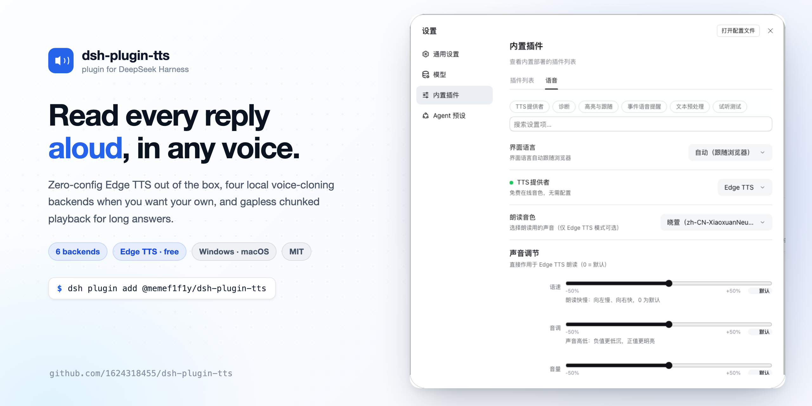

<p align="center">
  
</p>

<h1 align="center">dsh-plugin-tts</h1>

<p align="center">
  Read DeepSeek Harness replies aloud — Microsoft Edge TTS out of the box,<br />
  your own cloned voice when you want one.
</p>

<p align="center">
  <a href="LICENSE"></a>
  <a href="https://github.com/1624318455/dsh-plugin-tts/actions/workflows/test.yml"></a>
  <a href="https://www.npmjs.com/package/@memef1f1y/dsh-plugin-tts"></a>
  <a href="https://nodejs.org"></a>
  <a href="https://awesome-dsh-plugin.com"></a>
  <a href="https://github.com/1624318455/dsh-plugin-tts/stargazers"></a>
</p>

<p align="center">
  <b>English</b> · <a href="README.zh.md">简体中文</a>
</p>

<p align="center">
  <a href="https://raw.githubusercontent.com/1624318455/dsh-plugin-tts/main/assets/social-preview.png">
    
  </a>
</p>

---

A dual-sided plugin (Host + Web UI) that adds read-aloud to every assistant
message in the DSH web UI. It works with **zero setup** on Edge TTS, and grows
into a fully local pipeline — your own RVC model, Index-TTS2 / CosyVoice /
GPT-SoVITS reference-audio cloning — when you want a specific voice. Long
replies stream with gapless chunked playback instead of waiting for the whole
synthesis to finish.

## Install

```sh
# npm package (recommended)
dsh plugin --profile web add "@memef1f1y/dsh-plugin-tts"

# or straight from GitHub
dsh plugin --profile web add "github:1624318455/dsh-plugin-tts#main"

# or from a local checkout
dsh plugin --profile web add "file:/path/to/dsh-plugin-tts"
```

Restart `dsh web`; the plugin loads automatically as a profile bundle. The
dsh-market UI works too — search for the package name.

> Uninstall any existing copy before switching source. All three methods
> register the same loader entry id (`tts`), and the installer rolls back on a
> duplicate instead of overwriting.

## Six backends, one settings panel

Switch provider in 设置 → 插件 → 语音. Only the first row needs nothing installed.

| Backend | Synthesis runs | Prerequisite | Voice comes from |
|---|---|---|---|
| **Edge TTS** (default) | Microsoft, online, free | — nothing | 22 live-verified voices |
| **Google Cloud TTS** | Google, online, pay-as-you-go | your API key | 8 cmn-CN voices, or any voice id |
| **RVC** | your machine | RVC portable runtime + `rvc-server.py` (4892) | models you trained yourself (`.pth`) |
| **Index-TTS2** | your machine | local `index-tts2` API service (7880) | a reference-audio clip |
| **CosyVoice 2.0** | your machine | local `cosy-server.py` (7890) | a prompt clip + its transcript |
| **GPT-SoVITS** | your machine | local `api_v2.py` (9880) | a reference clip |

Each local backend needs its service package running; Edge and Cloud do not.
Ports are the defaults and are editable in the panel. No GPU is required —
CPU works, Apple Silicon MPS or an NVIDIA GPU just makes it faster.

The RVC panel takes a service URL (default `http://127.0.0.1:4892`), a source
voice, a model `.pth` and an optional `.index`, plus a collapsed advanced panel
(speaker id, f0 method, pitch, index rate, output sample rate, loudness mix,
consonant protection, filter radius, f0 curve file). Index-free mode works
without an index file.

→ Per-backend guides: [Edge](docs/EDGE-GUIDE.md) ·
[RVC](docs/RVC-GUIDE.md) · [Index-TTS2](docs/INDEX-TTS2-GUIDE.md) ·
[CosyVoice](docs/COSYVOICE-GUIDE.md) · [GPT-SoVITS](docs/GPT-SOVITS-GUIDE.md) ·
[Cloud](docs/CLOUD-GUIDE.md)

## What you get

**Reading**

- A **read-aloud button** on every finalized assistant message — click to speak
  it (animated equalizer while playing), click again to stop.
- An **auto-read toggle** in the composer row. On: every newly completed reply
  is read automatically. Off: nothing is read unless you ask.
- **Read selected text** — selecting text in a message raises a floating
  "朗读选中" chip that reads just that selection.
- A **mini player** on the message's action row: pause / resume, plus 1x /
  1.25x / 1.5x speed. Chunked long reads show a live "chunk x/y" counter.
- **Download audio** — MP3 for Edge and Cloud reads, WAV for the local
  backends (GPT-SoVITS follows its configured output format). Reuses the
  in-session cache, so a message you just heard downloads instantly.
- `Esc` or `S` (outside an input) stops the current read.

**Long replies**

- **Gapless chunked playback**: probe-calibrated chunk size, play-while-
  synthesizing, sample-accurate Web Audio joins, no audible gap between
  chunks. This applies to plain Edge reads too — the first chunk starts playing
  while the rest are still being synthesized.
- **Smart sentence splitting** never cuts URLs, emails, decimals or version
  numbers ("3.14") in half; hard cuts slide to a word or punctuation boundary,
  and a tiny trailing sentence merges backwards instead of sounding like a
  stutter.

**Voices**

- **One-click voice packs** from a registry URL — no manual file shuffling.
  Public example: [rvc-for-tts](https://github.com/1624318455/rvc-for-tts)
  (registry URL `https://raw.githubusercontent.com/1624318455/rvc-for-tts/main`).
- **Preview** any voice: type text, press the play button, failures show inline.
- **Sound tuning**: rate / pitch / volume (0 = provider default), shared by
  Edge and Cloud.

**Settings, language, safety**

- **Settings panel** with an in-panel **search box** that filters rows and
  collapses sections with no matches.
- **Interface language**: Auto (follow browser) / 中文 / English, applied
  immediately and persisted.
- **One-click diagnostics** covering every backend, with a copy button so a bug
  report is one paste. Export the JSON log and attach it to an issue.
- **Approval voice alerts** (opt-in, off by default): an approval request is
  announced aloud and interrupts the current read — the agent is waiting on
  you; an approval result is announced only when idle. Always Edge TTS with its
  own alert voice, deduplicated by approval id.
- **Clean reads**: message Markdown (code blocks, tables, links, quotes, task
  lists) is stripped before speaking, with an opt-in toggle to read the raw
  symbols verbatim when you want a source file read literally.
- **Quiet by default**: with Edge selected, the entire RVC section stays hidden
  behind a single "need a cloned voice?" entry, so casual reading is zero-config.

## Edge TTS voices (live-verified)

22 voices are verified working. Default is 晓萱 `zh-CN-XiaoxuanNeural`.

| Region | Voices |
|---|---|
| Simplified Chinese | Xiaoxuan 晓萱 · Xiaoyi 晓伊 · Yunxi 云希 · Yunyang 云扬 · Xiaoxiao 晓晓 · Yunjian 云健 · Yunxia 云夏 · liaoning-Xiaobei 晓北 · shaanxi-Xiaoni 晓妮 |
| Taiwan | HsiaoChen 曉臻 · HsiaoYu 曉雨 · YunJhe 雲哲 |
| Hong Kong | HiuGaai 曉佳 · HiuMaan 曉曼 · WanLung 雲龍 |
| English | Aria · Jenny · Guy · Sonia (UK) |
| Other | Nanami 七海 (ja-JP) · SunHi (ko-KR) · Denise (fr-FR) |

Cloud TTS adds 8 cmn-CN voices (default `cmn-CN-Wavenet-A`); any voice id can be
typed in by hand.

> Legacy voices (Xiaohan / Xiaomeng / Xiaorui / Xiaoshuang) were removed by the
> Edge endpoint (`1007 Unsupported voice`) and are no longer listed. If a voice
> disappears this way, the plugin prunes it from the picker and falls back to
> the default automatically.

## Requirements

- DeepSeek Harness `web` profile (`dsh web`)
- Node.js ≥ 22 (the worker uses the native `WebSocket`)
- Nothing else for Edge or Cloud. The local backends each need their own
  service package running — see the table above and the per-backend guides.

## Behaviour notes

- Clicking the read button of the message being auto-read stops it; clicking
  another message switches to manual reading of that message.
- Turning auto-read off never interrupts a manual read; it only stops auto reads.
- A newly completed message (auto on) interrupts the current read. Messages with
  no text are skipped. Switching sessions only stops auto reads.
- Stopping or switching messages **eagerly cancels** the active chunked job on
  the Host, so the local conversion service stops scheduling chunks and releases
  GPU / memory immediately instead of waiting for lazy GC.
- Reading the same text with the same voice **reuses the in-session cache**. If
  the OS cleaned the backing file, it re-synthesizes rather than serving a stale
  404 URL.
- Chunks are served strictly in order: background prewarm never overtakes an
  on-demand request, and a chunk that fails after one retry raises a
  "chunk failed, skipped (x/y)" toast and playback continues — order is never
  scrambled.
- Audio is **autoplay-unlocked on the first user gesture** (Web Audio context
  resumed + silent clip), so reads are not silently blocked by browser policy.
  The context is parked again when idle so it does not hold the system audio
  endpoint (this is what lets Windows idle-sleep work).
- Synthesis or playback failures raise a themed toast instead of failing
  silently. In RVC mode the toast offers a one-click **"read with Edge TTS
  instead"**; an opt-in setting can retry automatically with the RVC base voice
  via Edge (off by default — RVC is fully local, auto-fallback sends the text to
  Microsoft).
- **Archiving the session being read stops the read.** Keeping audio running for
  a conversation the user can no longer see is wrong; a new read for an
  already-archived session is refused. Session-less reads (settings preview,
  selection read, approval alerts) are unaffected.
- Approval alerts: the first poll after a page load only baseline-syncs the
  cursor, so refreshing never replays stale alerts. Failures stay silent — no
  error toast while the agent loops.

## Settings persistence

Two layers, on purpose:

- **Host file** `~/.dsh/tts-rvc/settings.json` —
  `{ version: 1, rvc: …, index: …, cosy: …, cloud: … }`. Service-class config:
  RVC service URL / model / index paths, Index-TTS2 and CosyVoice service URLs,
  Cloud API key (+ optional project ID). Shared across browsers, survives
  clearing browser data and incognito. Read and written over
  `GET /dsh-tts-api/rvc-config` + `POST /dsh-tts-api/rvc-config-save` (plus the
  matching `index-config`, `cosy-config`, `cloud-config` routes). Legacy
  `localStorage` values migrate up once, then the file wins.
- **localStorage** `dsh-tts-settings` — UI preferences only: voice, auto-read
  toggle, provider, sound tuning, the raw-Markdown toggle, approval-alert and
  remaining RVC prefs. Never the service URL / model / index.
- `dsh-tts-lang` holds the interface language.

"Reset to defaults" restores defaults and clears both layers (best-effort on the
Host file).

## Troubleshooting

**Edge TTS**

- **403 / `Sec-MS-GEC` rejected** — the Edge endpoint protocol or version check
  changed. Update `CHROMIUM_FULL_VERSION` / `TRUSTED_CLIENT_TOKEN` inside the
  worker in `lib/index.mjs`.
- **`1007 Unsupported voice`** — the voice was removed from the endpoint; pick
  one from the table above.
- **`websocket error … code=1006`** — the connection was cut without a close
  frame. That is transport-level, not a plugin error: usually an unstable proxy
  or a middlebox resetting the WSS connection. Check whether Edge synthesis
  works without a proxy, or switch to a local backend to isolate it.
- **No sound** — check system volume, the browser autoplay policy (interact with
  the page once), and the `[tts]` errors in the `dsh web` console.

**Everything else** — run 设置 → 语音 → 诊断 (one-click diagnostics). If a
problem persists, export the diagnostic JSON and attach it to an issue; it
contains the build id, provider settings, per-check results and the recent
error log, which is usually enough to locate the cause without a round trip.

→ [RVC troubleshooting](docs/RVC-GUIDE.md#troubleshooting) · each backend guide
has its own section.

## FAQ

**Is it big?**
- Edge TTS only: the plugin itself is tiny (MB scale) — no service, no model.
- Custom voices are where size comes from, and only if you opt in. The RVC
  portable package bundles an offline Python runtime, inference deps and
  pretrained models:

  | Platform | Archive | Extracted |
  |---|---:|---:|
  | macOS (Apple Silicon) | ~660 MB | ~1.3 GB |
  | Windows (CPU-minimal) | ~1–2 GB | ~2–3 GB |
  | Windows (with NVIDIA GPU) | ~6 GB | ~7 GB |

  For comparison, the full RVC WebUI is 7.8 GB — we ship only what reading
  actually needs.
- Index-TTS2 / CosyVoice / GPT-SoVITS are local bundles too; sizes vary by
  release, see each guide's preparation section.

**Is installing painful?**
- The plugin installs like any other (one command above).
- For a custom voice: download the portable package for your platform → unzip →
  run the launcher (double-click `.command` on macOS, `.bat` on Windows) → drop
  your `.pth` into `assets/weights` → pick it in the panel. Index-TTS2 /
  CosyVoice / GPT-SoVITS follow the same three beats: bundle → keep its service
  running → point the panel at a reference clip.
- No compiling, no manual Python or ffmpeg install. Note the **first macOS
  launch is slow** (tens of seconds) while macOS scans the extracted runtimes;
  later launches take a few seconds.

**Do I need a paid API or a local model?**
- Edge TTS: free, no API key, no model.
- RVC / Index-TTS2 / CosyVoice / GPT-SoVITS: fully local and free, but each
  needs its service package running. GPT-SoVITS needs **no** OpenAI or
  third-party API key either.
- Google Cloud TTS: pay-as-you-go with your own key. Chinese Standard voices are
  free for the first 4M chars/month, Wavenet / Neural2 / Chirp for the first 1M
  (local counters; Google Cloud Billing is authoritative). See the
  [Cloud guide](docs/CLOUD-GUIDE.md).
- For reference-only backends you provide a few seconds of clear speech, not a
  trained model.

**Does this modify DSH itself?**
- No. It is an independent plugin loaded through dsh's plugin mechanism. It
  doesn't touch the DSH main program and can be installed, paused or removed at
  any time without affecting DSH or other plugins.

**Other questions**
- **GPU needed?** No, CPU works. Apple Silicon MPS or an NVIDIA GPU (Windows,
  needs the CUDA torch build) makes it faster.
- **Privacy?** RVC / Index-TTS2 / CosyVoice / GPT-SoVITS convert locally — audio
  never leaves the machine. Edge TTS and Cloud TTS send the text to their
  online endpoints for synthesis.
- **Intel Macs?** The macOS build is arm64 (M1–M5); Intel would need a separate
  x86_64 build.

## Architecture

| Layer | Location | Role |
|---|---|---|
| Host | `lib/index.mjs` | Registers the webServer routes: `/dsh-tts-api/speak` (synthesis / chunk queue, all providers), `/dsh-tts-audio/<id>` (audio bytes), `/dsh-tts-api/rvc-next` (next chunk / cancel), `/dsh-tts-api/rvc-files` + `/rvc-compact-index` + `/rvc-packs*` (RVC proxy / voice packs), `/dsh-tts-api/index-*` and `/dsh-tts-api/cosy-*` (local service proxy + config), `/dsh-tts-api/cloud-*` (Cloud key / usage / test), `/dsh-tts-api/gsv-*` (GPT-SoVITS config / test), `/dsh-tts-api/notify` (approval-alert queue), `/dsh-tts-api/diagnose` (one-click diagnostics). Runs the zero-dependency Edge worker via `node -e`. |
| Client | `lib/client.js` | Web Audio chunk player (sample-accurate joins, `<audio>` fallback) in `shell.overlay`, plus the UI entries (read-aloud button / auto-read toggle / settings panel). Talks to the Host over `fetch`. |

The Edge worker mirrors
[node-edge-tts@1.2.10](https://github.com/SchneeHertz/node-edge-tts):
`Sec-MS-GEC` query params (ticks rounded down to the 5-minute boundary),
`Sec-MS-GEC-Version=1-143.0.3650.75`, `Path:audio` binary framing, `xml:lang`
derived from the voice locale, one retry on abnormal (1006) closures. Audio is
`audio-24khz-48kbitrate-mono-mp3`.

## Development

```sh
node tests/smoke.mjs    # route registration with a fake ctx + real Edge synthesis + audio serve
npm run test:all        # everything: smoke / live / patch / i18n / client / archive / gsv / gsv-e2e / pack / privacy / slots / audio
npm run test:pack       # guard on what `npm install` actually ships to users
npm run test:privacy    # guard against local usernames, absolute paths, GUI captures, credentials
```

Tests run from the source repo only. The published package is trimmed by the
`files` allowlist in `package.json`: `lib/`, `rvc-server.py`,
`cordis.patch.yml`, the seven user-facing guides under `docs/`, the two READMEs
and the license. Design notes, UI audit records, acceptance checklists and the
maintainer docs under `docs/maintainer/` stay in the source repo; `test:pack`
enforces that boundary. GPT-SoVITS talks straight to the local `api_v2.py` —
no gateway process, no Python adapter, no API key.

Hot-reload after editing `lib/` (on Windows a `file:` install is a copy, not a
symlink, so the running dsh reads the profile copy):

```powershell
Copy-Item lib/* $env:USERPROFILE\.dsh\profiles\web\node_modules\@memef1f1y\dsh-plugin-tts\lib\ -Recurse -Force
# then refresh the browser (bundles are re-read from disk per request; never use pnpm install --force)
```

## Known limits

- Audio cache is in-session only (files live in the OS temp dir and are cleaned
  by the OS), so a full restart re-synthesizes the first read of each text.
  Settings themselves persist across restarts (see above).
- zh/en **layout** fitting (English runs longer and may wrap or overflow) has to
  be eyeballed in a real dsh UI with the plugin loaded. The plugin ships no
  standalone HTML — its UI is slot-injected by the dsh web host — so
  `tests/client-load.mjs` asserts the in-memory render only, not real DOM/CSS.

## Documentation

| Doc | What's in it |
|---|---|
| [User guide](docs/USER-GUIDE.md) | Step-by-step for first-time users: what / how / how to tell it worked |
| [RVC guide](docs/RVC-GUIDE.md) | Custom voices, chunked playback, compact index, voice packs, portable runtime |
| [Index-TTS2 guide](docs/INDEX-TTS2-GUIDE.md) | Local reference-audio voices |
| [CosyVoice guide](docs/COSYVOICE-GUIDE.md) | Local zero-shot prompt cloning (CosyVoice-2.0-0.5B) |
| [GPT-SoVITS guide](docs/GPT-SOVITS-GUIDE.md) | Direct local `api_v2.py /tts`, reference cloning, payload contract |
| [Cloud guide](docs/CLOUD-GUIDE.md) | Paid Google voices, API key, usage and billing |
| [Edge guide](docs/EDGE-GUIDE.md) | The default online path |
| [Chunked playback design](https://github.com/1624318455/dsh-plugin-tts/blob/main/docs/adaptive-chunked-playback.md) | How gapless long reads work (source repo only) |
| [Host contract](https://github.com/1624318455/dsh-plugin-tts/blob/main/docs/HOST-CONTRACT.md) | The Host-side route contract, for anyone extending the API (source repo only) |
| [Changelog](https://github.com/1624318455/dsh-plugin-tts/blob/main/CHANGELOG.md) | Release notes (source repo only) |

## Community

- [Discussions](https://github.com/1624318455/dsh-plugin-tts/discussions) —
  setup help, voice packs, show and tell.
- [Issues](https://github.com/1624318455/dsh-plugin-tts/issues) — reproducible
  bugs. Attach the diagnostic JSON (设置 → 语音 → 诊断) and the `dsh web`
  console lines.

## License

MIT
